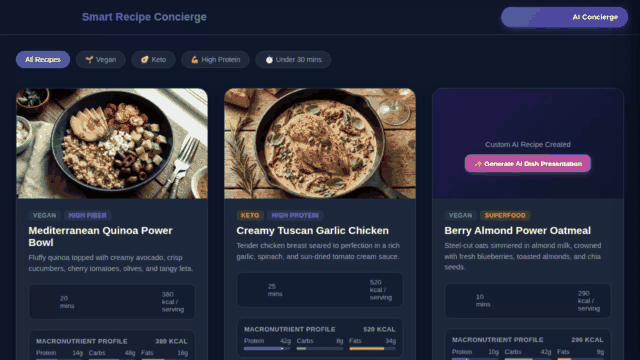

# Smart Recipe Concierge

An intelligent culinary AI agent built with Google's **Agent Development Kit (ADK)** and deployed to **Agent Runtime**. The agent provides personalized meal planning, dietary safety filtering, recipe scaling, real-world recipe discovery, AI food photography generation, and AI recipe video generation.



---

## Key Features & Wired Capabilities

All capabilities listed below are fully implemented in code in the [`app/`](file:///config/Desktop/Session1/smart-recipe-concierge/app/) directory and registered in [`agents-cli-manifest.yaml`](file:///config/Desktop/Session1/smart-recipe-concierge/agents-cli-manifest.yaml):

* **Cross-Session Long-Term Memory (Vertex AI Memory Bank)**
  * Uses `VertexAiMemoryBankService` to extract and persist durable user facts (allergies, dietary restrictions, family size) across sessions.
  * Automatically checks user memories before making recipe recommendations via `PreloadMemoryTool` and `generate_memories_callback`.

* **Firestore Database Integration**
  * `search_recipes`: Filter recipes in Firestore by dietary tag (`vegan`, `keto`, `gluten-free`), keyword, or maximum calorie threshold.
  * `get_recipe_details`: Fetch full recipe documents including step-by-step instructions and ingredient lists.
  * `add_recipe`: Persist new custom user-created recipes into Firestore.

* **Dynamic Ingredient Scaler**
  * `scale_ingredients`: Recalculates ingredient quantities dynamically based on target serving size ratios.

* **External Global Recipe Search**
  * `fetch_external_recipes`: Connects to **TheMealDB** public API to retrieve global recipes, ingredients, instructions, and thumbnail links.

* **AI Food Photography Generation**
  * `generate_recipe_image`: Generates high-quality dish photography using Google's `gemini-3.1-flash-lite-image` model on Vertex AI (`global` region).
  * Saves images as Playground artifacts (`tool_context.save_artifact`) and streams bytes directly to Google Cloud Storage.

* **AI Recipe Video Generation**
  * `generate_recipe_video`: Generates short food preparation videos using Google's Omni model (`gemini-omni-flash-preview`) in the `global` region via the Vertex AI REST Interactions API.
  * Saves videos as Playground artifacts and uploads bytes directly to Google Cloud Storage.

* **Google Cloud Storage Integration**
  * Directly uploads generated media bytes to Cloud Storage bucket (`smart-recipe-concierge-images-563a`) and returns public HTTPS URLs.

* **Code Execution Sandbox**
  * Uses `AgentEngineSandboxCodeExecutor` to safely run Python code for complex nutrition math, macro splits, and ingredient ratio calculations in an isolated sandbox environment.

* **Rich UI Rendering (A2UI v0.8)**
  * Built with `A2uiSchemaManager` (v0.8) and `BasicCatalog`.
  * Formats response payloads with `a2ui_callback` so responses render as rich display cards in `adk web` and custom frontends.

* **Custom Web Frontend & FastAPI A2A Proxy**
  * Lightweight FastAPI proxy (`frontend/main.py`) translating frontend chat requests to the deployed agent over the **A2A Protocol**.
  * Modern UI (`frontend/static/index.html`) featuring an **AI Concierge** side drawer, Memory Hub badges, dynamic serving scaler, and macro nutrient breakdown widgets.

---

## Project Structure

```
smart-recipe-concierge/
├── app/
│   ├── agent.py               # Core ADK agent, tools, system prompts, and memory wiring
│   └── a2ui_utils.py          # A2UI v0.8 message formatting and card sanitizer callback
├── frontend/
│   ├── main.py                # FastAPI proxy server connecting web UI to Agent Runtime (A2A)
│   └── static/
│       └── index.html         # Smart Recipe Concierge frontend web UI
├── demo.gif                   # Demo video recording
├── agents-cli-manifest.yaml   # Agents CLI project manifest configuration
├── deployment_metadata.json   # Agent Runtime deployment resource tracking
├── pyproject.toml             # Python project dependencies
└── Dockerfile                 # Cloud Run deployment container build file
```

---

## Setup & Local Run Instructions

### Prerequisites
- Python 3.11+
- `uv` package manager
- `google-agents-cli` toolchain
- Authenticated Google Cloud SDK (`gcloud auth login` and `gcloud auth application-default login`)

### 1. Install Dependencies

```bash
agents-cli install
```

### 2. Run Local Agent Playground

To test and debug the agent interactively in the ADK web development interface:

```bash
agents-cli playground
```

### 3. Run the Custom Web Frontend

To launch the FastAPI proxy server and frontend interface locally:

```bash
cd frontend
export AGENT_ENGINE_RESOURCE_NAME="projects/<PROJECT_NUMBER>/locations/us-east1/reasoningEngines/<RESOURCE_ID>"
export AGENT_DIRECTORY="app"
uv run python main.py
```

---

## Deployment

Deploy the agent to **Agent Runtime** using `agents-cli`:

```bash
gcloud config set project <YOUR_GCP_PROJECT_ID>
agents-cli deploy
```

Deploy the FastAPI proxy frontend to **Cloud Run**:

```bash
gcloud run deploy smart-recipe-frontend \
  --source ./frontend \
  --region us-east1 \
  --allow-unauthenticated \
  --set-env-vars AGENT_ENGINE_RESOURCE_NAME="<YOUR_AGENT_RESOURCE_NAME>",AGENT_DIRECTORY="app"
```
